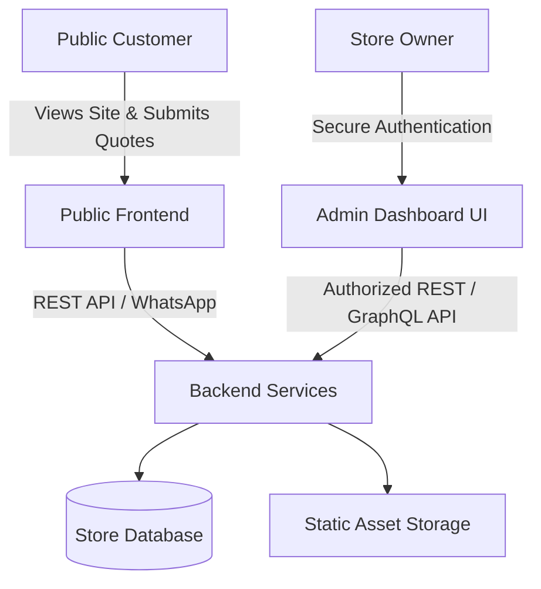

# Paint Palace — Admin Dashboard Architecture

> [!NOTE]
> **Status**: Planned / Architectural Specification.
> This directory reserves the architectural boundaries for the Paint Palace store management system.
> The admin dashboard is not yet implemented in code to keep the current public-facing storefront lightweight and focused.

---

## 1. Core Principles & Access Control

- **Single Authorized Owner Account**:
  - Paint Palace is an owner-operated establishment in Nilambur.
  - Access is strictly restricted to one pre-configured administrative account with multi-factor authentication (MFA / SMS or Authenticator TOTP).
  - No public registration or multi-tenant role complexity.
- **Isolated Surface**:
  - The admin dashboard operates behind a dedicated `/admin` entry point or separate sub-application.
  - Public visitors cannot view, load, or probe admin bundle logic.
  - The public frontend design, styling, and WhatsApp quick-quote functionality will remain 100% untouched when the admin dashboard is plugged in.

---

## 2. Planned Functional Modules

### A. Product Catalogue Management
- **Add / Edit / Archive**: Manage paint finishes, coverage specifications, packaging units (1L, 4L, 10L, 20L), and base prices.
- **Image Management**: Upload, preview, and organize high-resolution product photography into `frontend/assets/images/products/`.
- **Status Toggling**: Toggle products between `Active`, `Draft`, and `Out of Stock`.

### B. Category & Brand Management
- **Brands**: Manage authorized dealership listings (Asian Paints, Berger, Dulux, JSW, Nerolac, MRF, 3M, NCI, etc.), logos, and banner features.
- **Categories**: Reorder and feature Home Paint (Interior, Exterior, Wood & Metal, Primers & Putty, Waterproofing) and Automotive Paint lines.

### C. Manual Inventory Adjustments & Stock History Log
- **Direct Count Adjustments**: Quick adjustment interface for in-store stock counts.
- **Audit Log**: Every modification records:
  - Timestamp
  - Previous quantity vs. new quantity
  - Reason code (Restock shipment, Store sale, Damaged/expired, Manual audit correction)
  - Operator notes
- **Low-Stock Alerts**: Visual badges and automated alerts when critical inventory falls below configurable thresholds.

### D. Customer Enquiry & Quote Request Pipeline
- **Enquiry Inbox**: View submissions from the website's instant estimate calculator and contact form.
- **Status Workflow**: `New` ➔ `Contacted` ➔ `Quote Issued` ➔ `Order Placed` / `Closed`.
- **WhatsApp Integration**: Single-click WhatsApp chat launch with pre-filled quotation replies directed to the customer's phone number.

### E. Manual Order Creation & In-Store Tracking
- Record walk-in and telephone orders.
- Itemized paint selection, volume calculation, and final invoiced amount.
- Payment status tracking (Pending, Paid via UPI / Cash / Card).

---

## 3. Integration Blueprint

- The Admin UI interacts strictly with the `backend/` API routes (`/api/admin/*`).
- Changes made in the admin panel update the database, which in turn feeds the product listings queried by the frontend.
